# 抽奖页 · 贴图版（三套主题 × 大奖 / 二奖 / 三奖）

2026-10-24 在设计稿画布上定稿（画布是私有的，实现时以本目录为准）。三套主题的开奖特效、主体元素、
中奖名单和常挂结果都换成位图素材，横屏、竖屏都有。实现任务：[GitHub Issue #242](https://github.com/cyaoc/aether/issues/242)。

- `textures/`：定稿素材，28 张 WebP，约 2 MB。**直接用，不要重新生成**；来源见 `prompts.md`。
- `boards/`：画板源码。所有数值（时间轴、位置、尺寸、切片、上色）以这里为准，本文只做导读。
  贴图版在画板里是 `fx=贴图`；画板里的 `/_blob/<id>` 对应哪张图见 `tools/blobs.json`。
- `preview/`：参考截图（画板一半尺寸，浅色房间）。
- `tools/`：在本地打开画板的小工具。

## 在本地打开画板

```sh
node docs/design/lottery-textures/tools/server.mjs 8793
```

然后用浏览器打开 `http://localhost:8793/render.html?board=<画板文件>&props=<JSON>&freeze=<毫秒>`。
`props` 是画板的 data-props，`freeze` 把所有 CSS 动画停在那个时刻（画布粒子不冻结）。常用的：

| 画面 | board | props |
|---|---|---|
| 横屏开奖 | `W1-PoolSummon.dc.html` / `W2-PoolMecha.dc.html` / `W3-PoolGacha.dc.html` | `{"stage":"揭晓","tier":"大奖","fx":"贴图","room":"浅色房间"}` |
| 竖屏开奖 | `PW1-PoolSummonPortrait.dc.html` / `PW2-…` / `PW3-…` | 同上 |
| 转动中 | 同上 | `"stage":"转动中"` |
| 中奖名单 / 已截止 | 同上 | `{"mode":"报名","stage":"中奖名单","fx":"贴图"}`，`stage` 可换 `已截止` |
| 常挂结果 | `RB1-PinBoard.dc.html` | `{"theme":"星辰召唤","fx":"贴图"}`，另有 `orient`、`stage`、`mode`、`tier` |

截图可以用无头 Chrome：`--headless=new --window-size=1920,1080 --virtual-time-budget=2500 --screenshot=out.png "<上面的地址>"`。

画板的时间轴和抽奖页不同：画板命中在 36.5%，抽奖页在 28%（结果要停 4 秒），对照时沿用现有换算
（星辰召唤、机甲锁定：页面时刻 = 画板时刻 − 490 ms；萌系扭蛋开蛋后的关键帧 = 画板 % − 8.7%）。

## 三档怎么区分

不只靠颜色：材质、装饰多少、明度和档位符号都不同。

| | 大奖 | 二奖 | 三奖 |
|---|---|---|---|
| 材质 | 最贵重：金、宝石、重装甲、缎带皇冠 | 次一级：银和紫晶、亮钢、蕾丝 | 朴素：蓝钢、全息细线、简单花边 |
| 形状 | 顶部有徽记或皇冠，四角有大装饰 | 只在四角有装饰 | 素边或小角钉 |
| 明度 | 最亮最暖 | 中 | 偏冷偏暗 |
| 符号 | SSR / S 徽章 / 皇冠 | SR / A 徽章 | R / B 徽章 |

## 通用规则

- **贴图的两种用法**：发光类素材是白色加透明度，按档次上色。CSS 里用作 `-webkit-mask`，底色给档次色；
  画布里先把贴图画到离屏画布，用 `source-in` 填色，再以 `lighter` 叠回 60% 的原图保留白色亮芯，
  每种颜色和尺寸缓存一份。框、贴纸、牌面、扭蛋等彩色素材直接画。
- **框**一律用九宫格：`border: 1px solid transparent` 加 `border-image: url() <切片> / <百分比宽度> stretch`。
  宽度给百分比（相对框自身），同一个 class 才能同时用在大卡和小卡上。具体数值见下面各表。
- **开头不透底**：传送门、圆罩、粉色光晕各加一层核心底色，从中心一点张开，第一帧就不透明，
  不再从透明淡入（以前淡入的头 0.35 秒会透出直播画面里的东西）。核心在约 60% 半径内保持 0.9 不透明，
  到 82% 淡到 0。
- **四边 40 px 不露底**、**文字底板**等现有规则不变：光爆缩到 960 px（竖屏 900），命中闪光、冲击波都收在素材里面。
- 位图素材全部在页面加载时预载、解码好，开奖时不再等图片。
- 遮罩只用 `-webkit-mask*`（直播姬 CEF 105 不支持不带前缀的 `mask` 简写）。

## 星辰召唤

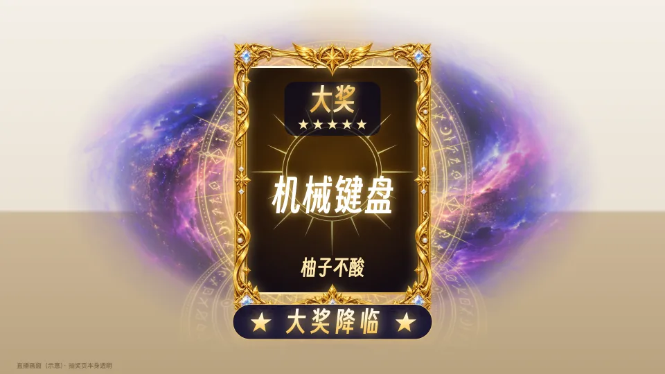 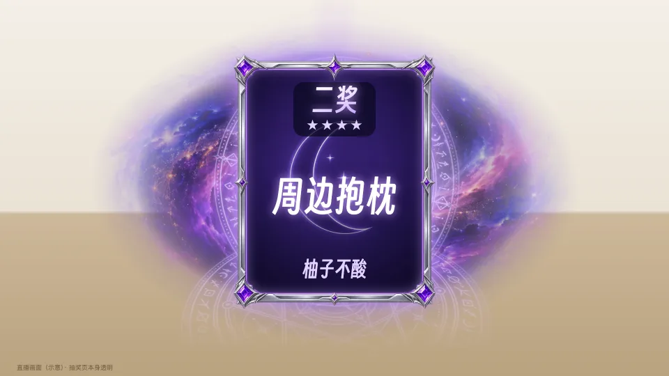 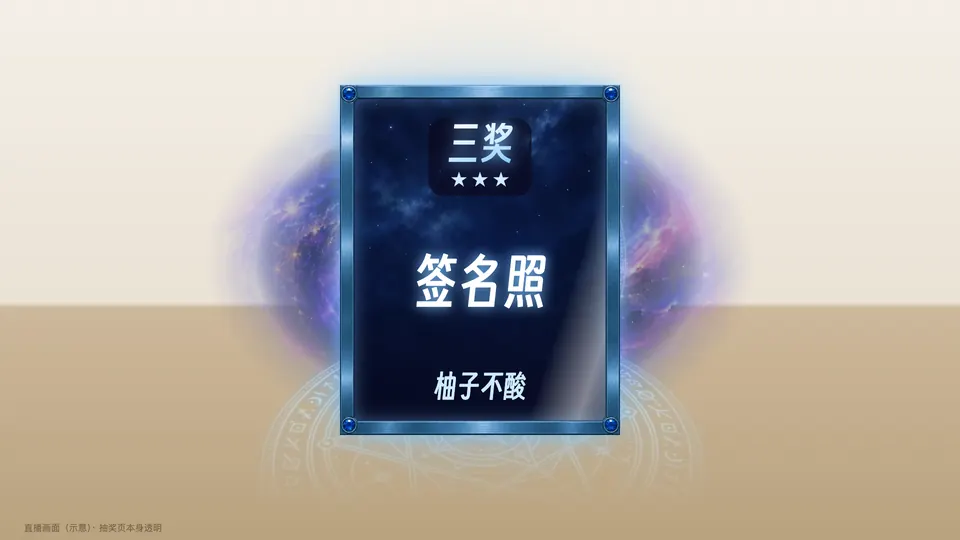
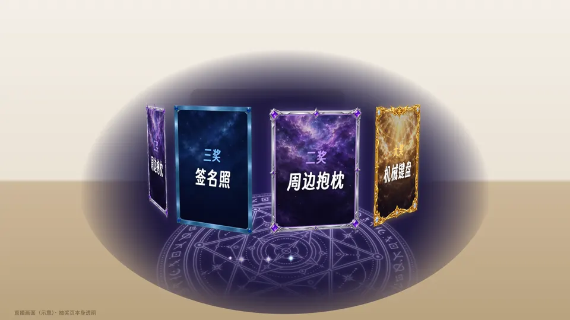

| 元素 | 贴图版 | 素材 |
|---|---|---|
| 传送门 | 原来的深色椭圆上，加核心底色和慢慢转的星云（−5°→9°，7 秒，`inset:-6%`），星云不透明度 1 / 0.85 / 0.7。竖屏的传送门是竖椭圆，星云转 90° 放，不拉伸 | nebula |
| 地面法阵、卡后光阵 | 法阵贴图作遮罩，按档次色上色，`drop-shadow` 发光 | circle |
| 大奖放射光 | 只有大奖，光爆贴图作遮罩，白 → 档次浅色 → 档次主色 | burst |
| 粒子、命中闪光 | 星屑换成星芒贴图（星形粒子半径 = s×9，圆点 = s×5 再补一个小实心点）。命中时 2540 ms 起 900 ms 内画一道横向拉长的光斑加一个圆光斑 | flare |
| 彗星（大奖、二奖） | 彗星贴图作遮罩，渐变白 → 浅色 → 主色。下面垫一层放大 1.14 倍、`rgba(28,14,70,.42)` 的影子，浅色直播间也看得到。大奖 600×200，二奖 420×140，三奖没有；头部对准流星点，横屏转 −45.7°，竖屏 −61.4° | comet |
| 揭晓的大卡 | 牌面插画放在文字下面（z-index −1，卡片 `isolation:isolate`），上面盖一层由浅到深的暗色渐变；外面套档次卡框。档次字放在深色底板上（`rgba(10,8,30,.72)`），二奖、三奖的字改成浅色渐变 | face-*、frame-* |
| 卡背 | 卡背插画铺满 | card-back |
| 转动中的小卡 | 每张按自己奖品的档次用对应牌面和卡框 | face-*、frame-* |

卡框的九宫格：

数值都按 CSS 简写的顺序（上 右 下 左）：

| 素材 | 切片 | 宽度 | 外扩：横屏大卡 / 竖屏大卡 |
|---|---|---|---|
| frame-ssr | 139 75 143 75 | 13% 9.7% 13.3% 9.7% | −76 −34 −78 −34 / −64 −29 −66 −29 |
| frame-sr | 113 75 75 75 | 11.6% 9.77% 7.7% 9.77% | −43 −36 / −36 −30 |
| frame-r | 53 | 5.47% 6.84% | −26 / −22 |

转圈的小卡外扩 −12 −10（竖屏 −10 −8），名单小卡 −10 −8（竖屏 −9 −7），宽度同上。

## 机甲锁定

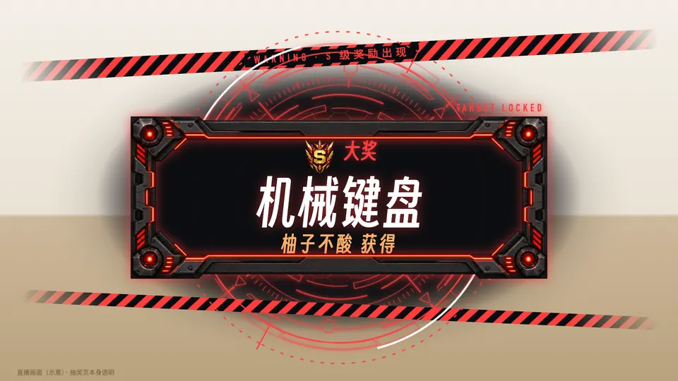 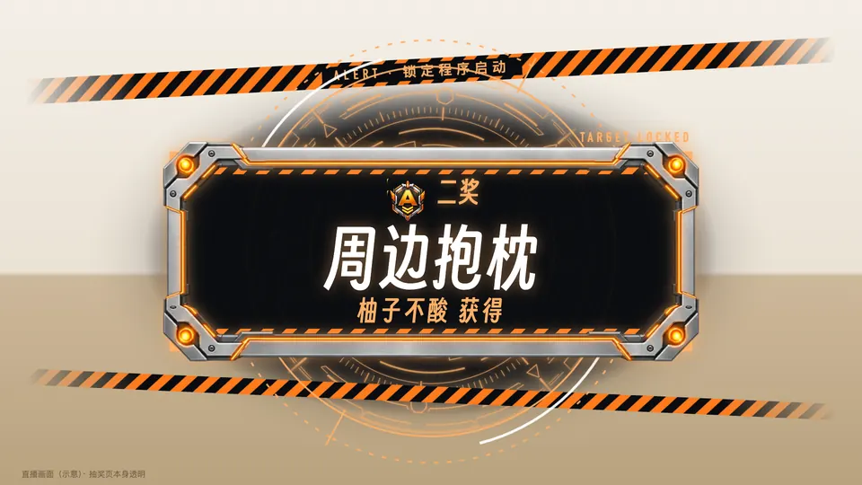 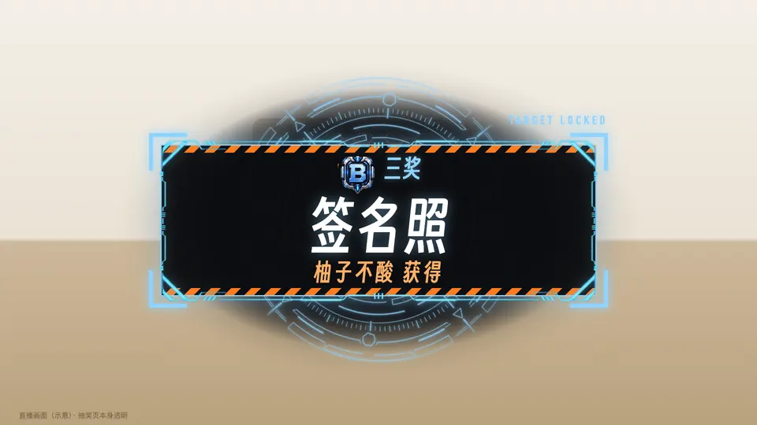
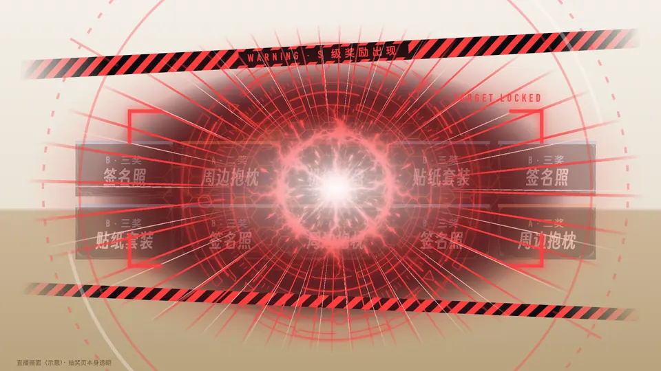 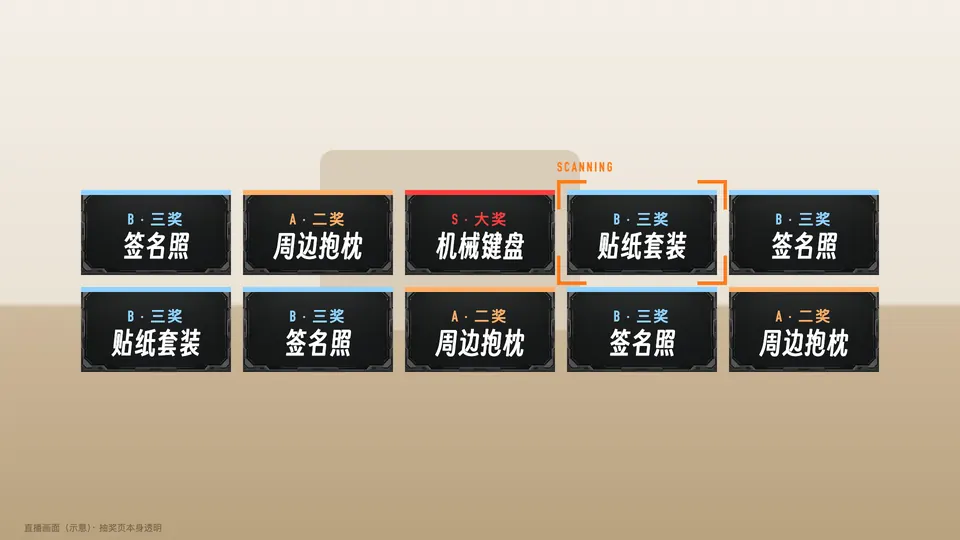

| 元素 | 贴图版 | 素材 |
|---|---|---|
| 圆罩 | 加核心底色（第 0–4% 从 0.06 放大到 1），六边形网格作遮罩、填 `#FF7A1A`、不透明度 0.6；竖屏转 90° | grid |
| HUD 圆环 | 代替原来的 SVG 细线圈，按档次主色上色，不透明度 0.8，转动沿用原动画 | hud |
| 锁定冲击波 | 面板后面，36.8% 出现、37.3% 最大、45% 消失，尺寸 700 / 620 / 520（竖屏 600 / 520 / 440） | shock |
| 结果面板 | 套档次面板框；“S 级”文字换成徽章（横屏 104 px，竖屏 88 px） | panel-*、emblems |
| 目标格 | 金属底板用九宫格 `fill` 铺满（角 26 px，竖屏 22 px），档次色条保留 | tile |

| 素材 | 切片 | 宽度：横屏 / 竖屏 | 外扩 |
|---|---|---|---|
| panel-s | 133 | 32.6% 12.7% / 30% 17.86% | −40 |
| panel-a | 110 100 | 26.2% 10.05% / 24.3% 14.05% | −55 −47 −69 −47 |
| panel-b | 60 | 20.8% 8.04% / 19.07% 11.54% | −24 −10 −28 −10 |

徽章图集 `emblems.webp` 是 3 格横排（S、A、B），`background-size:300% 100%`，位置 `0` / `50%` / `100%`。

## 萌系扭蛋

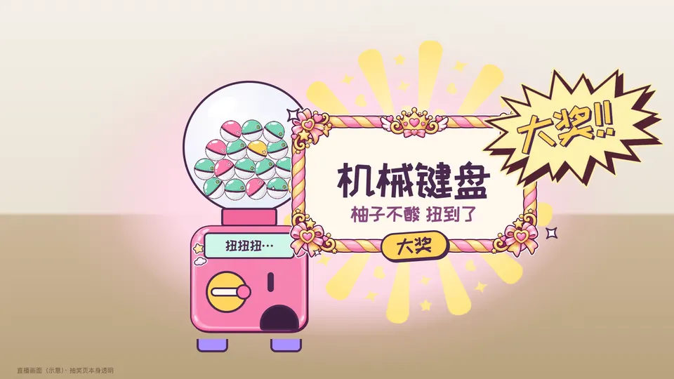 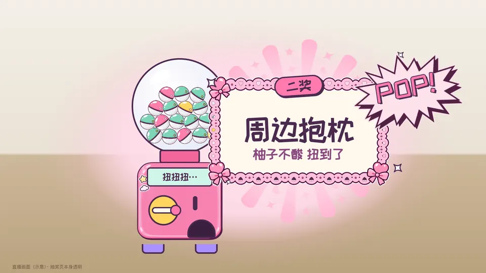 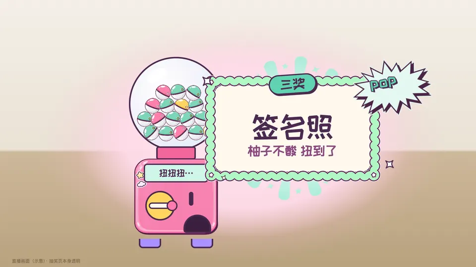
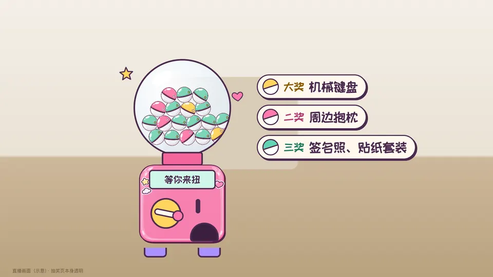

| 元素 | 贴图版 | 素材 |
|---|---|---|
| 粉色光晕 | 加浅粉核心（0–4% 从 0.06 弹到 1.04，5.5% 回到 1） | — |
| 放射光 | 放射光贴图作遮罩，白 → 档次浅色 → 档次色 | sunburst |
| 中奖贴纸 | 套档次贴纸框。大奖的框顶有皇冠，“大奖”标签挪到贴纸下沿（横屏 top 320 px，竖屏 296 px） | frame-* |
| 爆炸贴纸 | 贴纸原图，上面叠一层同形遮罩、填档次底色、`mix-blend-mode:multiply`（外层 `isolation:isolate`）；比原来的框各边外扩 12% | pow |
| 扭蛋 | 球罩里的、滚出来的、开蛋的两半都用扭蛋图集；两半用同一张图的上半和下半（`background-position`） | capsules |
| 机身 | 机身图代替粉色底、描边和投影；屏幕、摇把、投币口、出口仍用代码画在上面（摇把要转） | body |
| 彩纸 | 彩纸图集按形状取列（爱心、星星、飘带、糖果），按颜色取行（粉、黄、薄荷、紫/蓝），尺寸 r×2.4，条形彩纸保留翻转 | confetti |

| 素材 | 切片 | 宽度：横屏 / 竖屏 | 外扩：横屏 / 竖屏 |
|---|---|---|---|
| frame-grand | 173 | 27.8% 16.9% / 28.1% 16.8% | −36 / −34 |
| frame-second | 133 | 22.6% 13.85% / 22.9% 13.76% | −41 / −38 |
| frame-third | 80 | 12.56% 7.6% / 12.63% 7.5% | −35 / −33 |

扭蛋图集 `capsules.webp` 是 3 格横排（金、粉、薄荷，对应大奖、二奖、三奖），每格正好是一颗扭蛋。
彩纸图集 `confetti.webp` 是 4×4、每格 96 px。

## 中奖名单和常挂结果

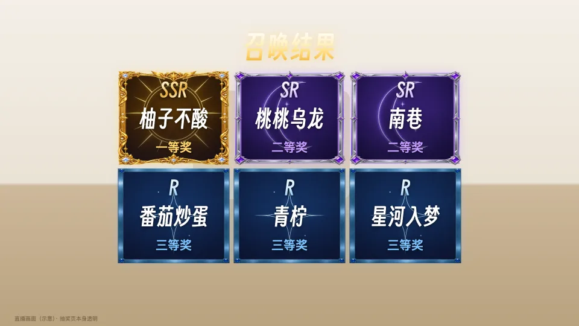 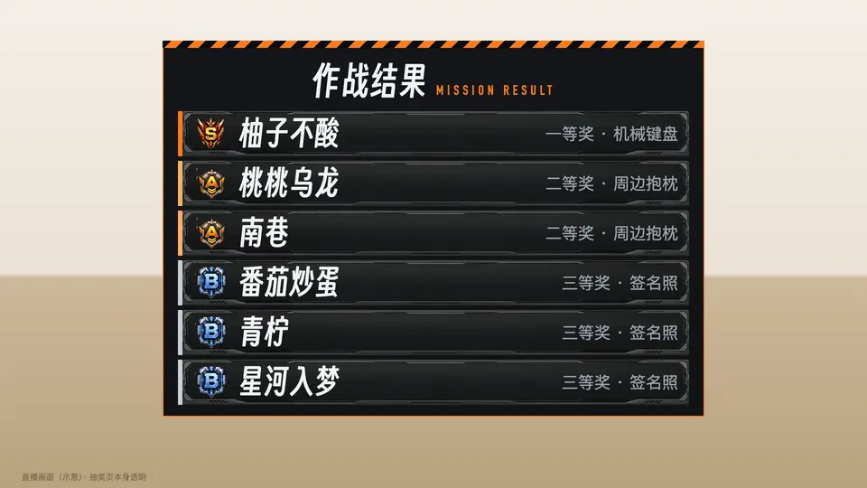 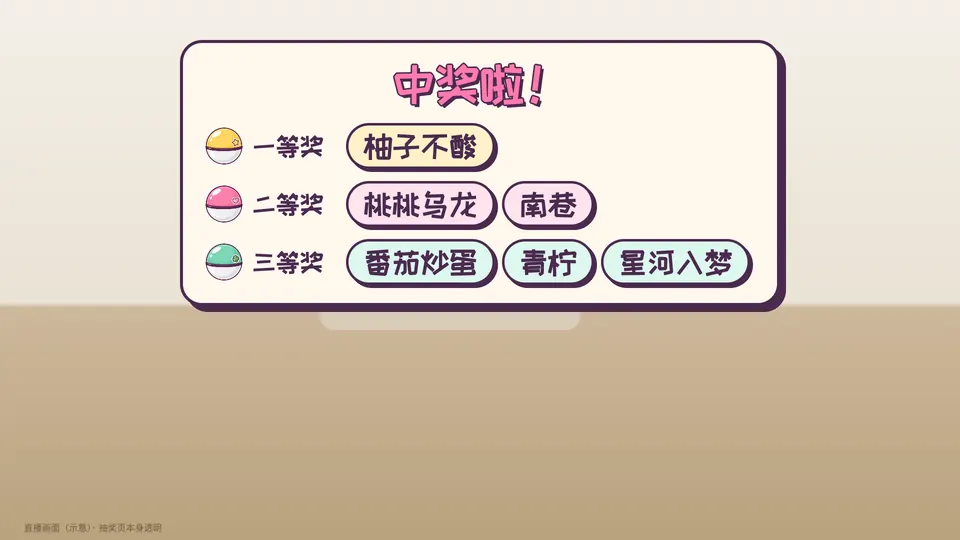
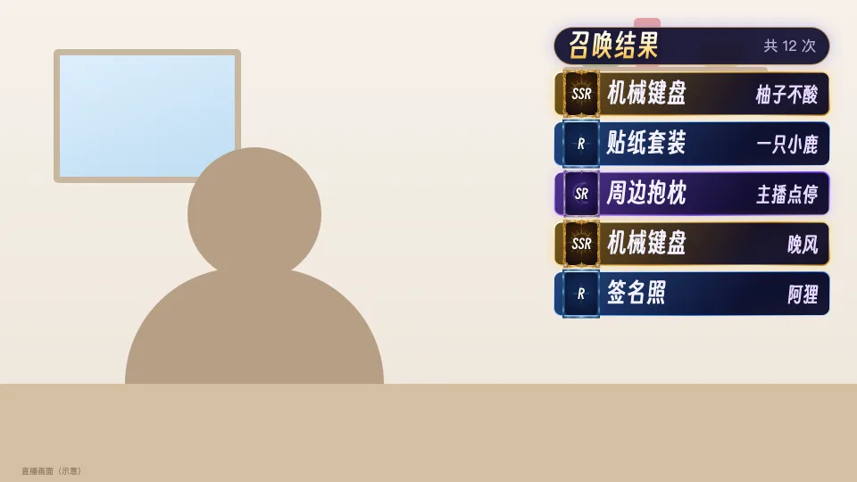 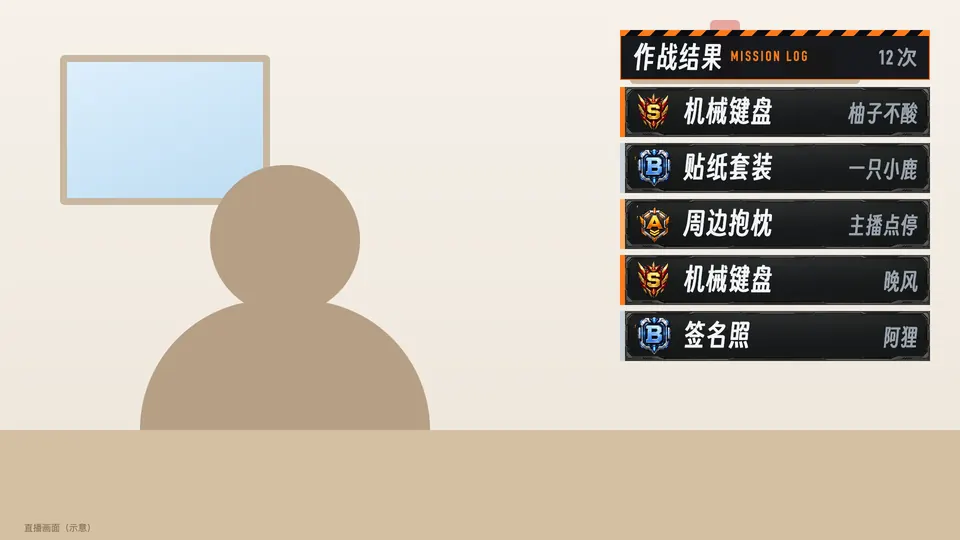 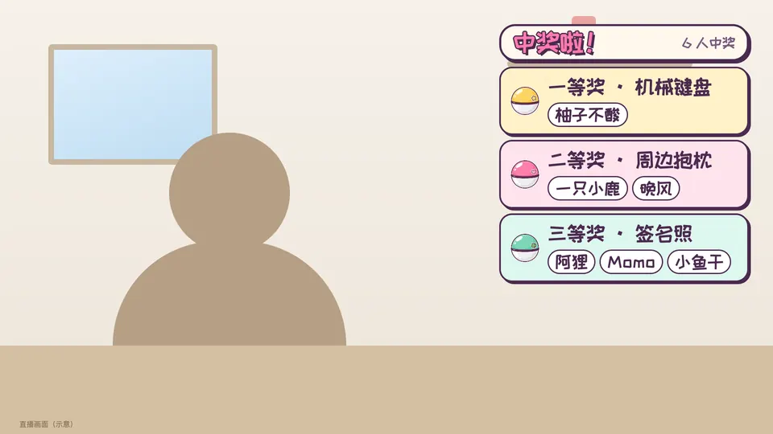

只把档位标记换成和开奖同一套的小图，不加特效，名单和“已截止”是同一套排版：

- 星辰召唤：名单小卡用档次牌面和卡框，名字、档次字加深色投影；常挂结果的 SSR/SR/R 变成小卡缩略（72×96，牌面加卡框）。
- 机甲锁定：每行左边的字母换成徽章，行底换成金属底板（常挂结果角 18 px），颜色左边条保留。
- 萌系扭蛋：扭蛋图标换成扭蛋图集，名字胶囊不动。

## 竖屏

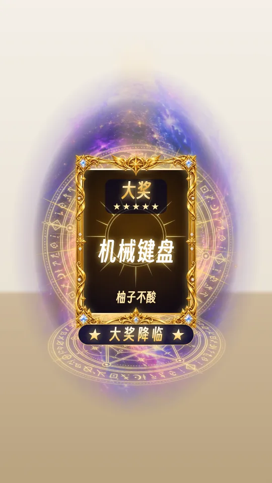 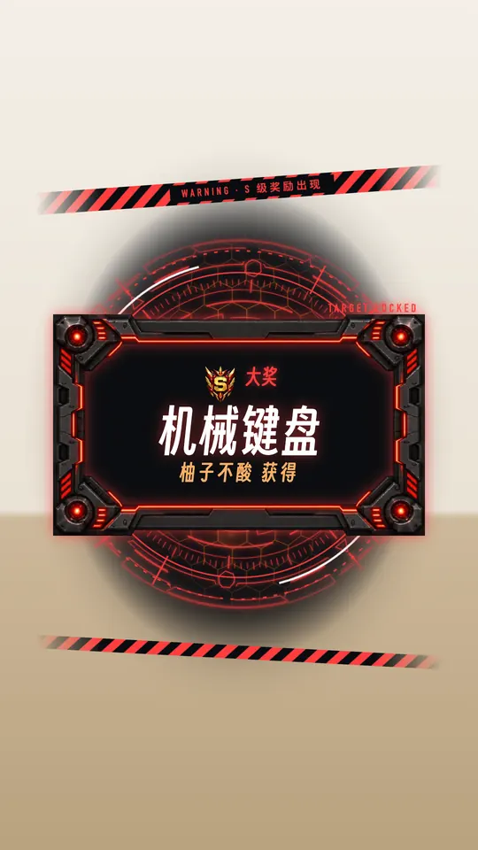 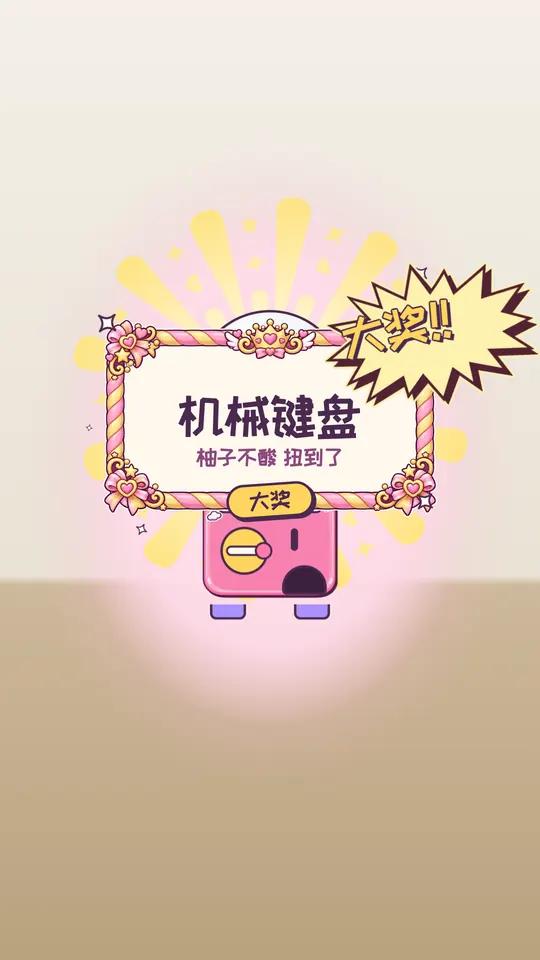

做法和横屏一样，数值见各自的画板（`PW1`–`PW3`、`RB1` 的 `orient=竖屏`）。命中闪光改成 (260 + 220e) 的宽度，免得碰到窄素材两侧。
