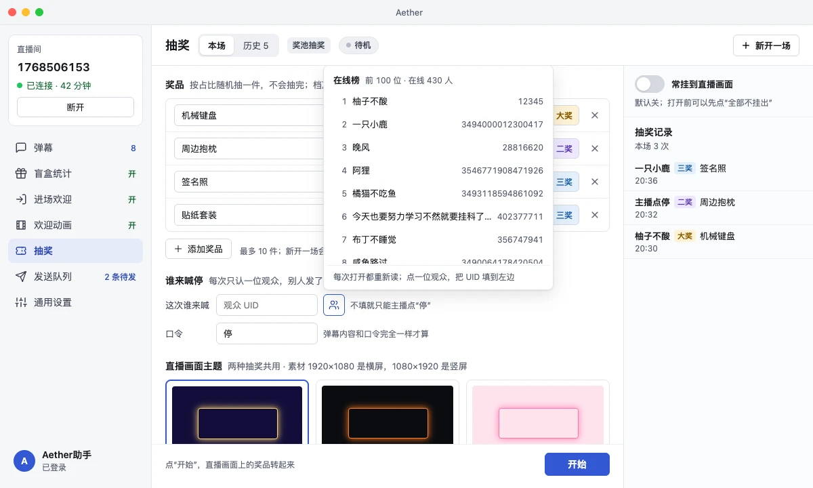
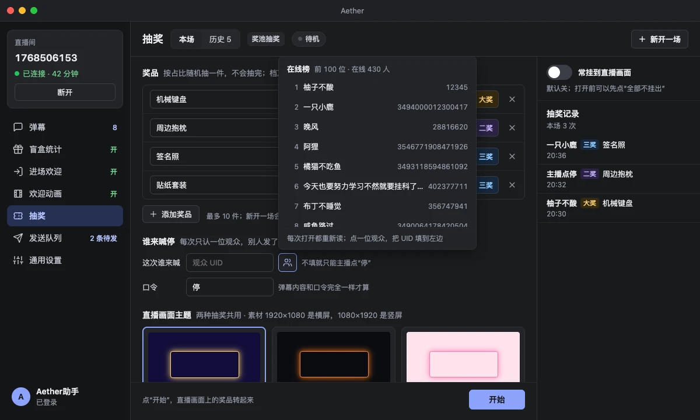
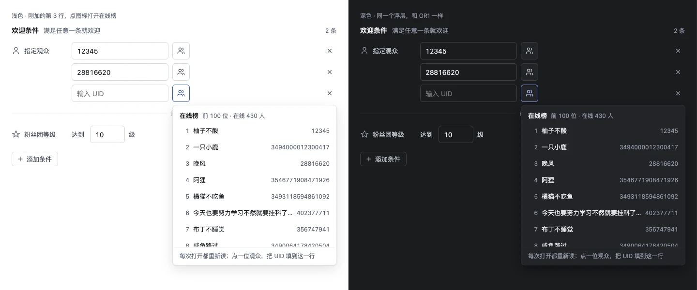
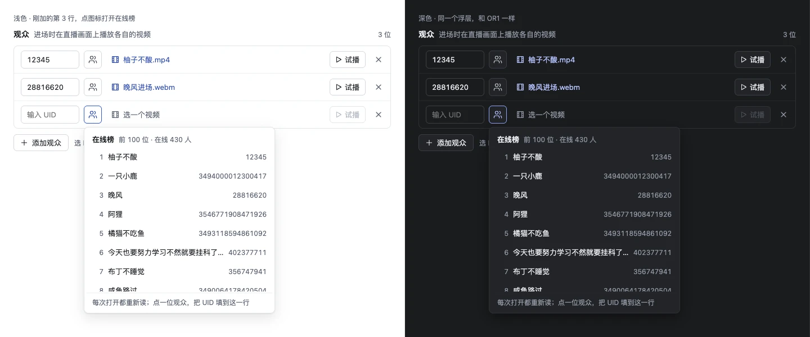
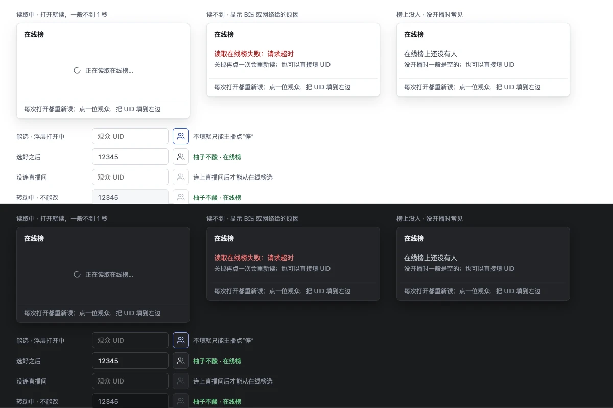

# UID 从在线榜选（奖池抽奖、指定观众、欢迎动画）

2026-10-25 在设计稿画布上定稿（画布是私有的，实现时以本目录为准）。三处 UID 输入框都保留，
后面紧跟同一个按钮，点开浮层列出直播间在线榜前 100 位，点一位就把 UID 填进这个框。

- `boards/`：画板源码，所有尺寸和颜色以这里为准，本文只做导读。OR2 只是 OR1 的深色版（`dark=true`）。
- `preview/`：参考截图（画板原尺寸）。
- `tools/`：在本地打开画板的小工具，复用 `lottery-textures` 的渲染页。

## 在本地打开画板

```sh
node docs/design/online-picker/tools/server.mjs 8796
```

然后用浏览器打开 `http://localhost:8796/render.html?board=<画板文件>&props=<JSON>`：

| 画板 | 内容 | props |
|---|---|---|
| `OR1-OnlinePicker.dc.html` | 奖池抽奖「这次谁来喊」，浮层打开 | `{}`；深色 `{"dark":true}`；`state` 可换 `读取中` `读不到` `榜上没人` `没连直播间` |
| `OR3-OnlinePickerStates.dc.html` | 浮层三种状态、按钮四种状态，浅色 / 深色 | `{}` |
| `OR4-OnlinePickerWelcome.dc.html` | 进场欢迎「指定观众」每行，浮层打开 | `{}` |
| `OR5-OnlinePickerAnimation.dc.html` | 欢迎动画「观众」每行，浮层打开 | `{}` |

本地渲染页只做静态截图，点击交互要在画布上看。







## 按钮（三处一样）

| 项 | 值 |
|---|---|
| 位置 | 紧跟在 UID 输入框右边，间距 8 |
| 形状 | 正方形，边长 = 旁边 UID 框的高度；圆角 6；1 px 描边；底色 `Surface.Card` |
| 图标 | 现有的 `Icon.Users`，16×16；没有文字、没有下拉箭头 |
| 悬停提示 | 「从在线榜选」；不能点时换成原因（见下） |
| 读屏名称 | 说明是哪一处：「从在线榜选喊停观众」「从在线榜选第 N 位指定观众」「从在线榜选第 N 位观众」 |
| 平时 | 描边 `Border.Control`，图标 `Text.Secondary` |
| 浮层打开中 | 描边 `Accent`，图标 `Accent.Text` |
| 不能点 | 描边 `Border`，图标 `Text.Disabled`。没连直播间：提示「连上直播间后才能选」；奖池抽奖转动中：提示「转动中不能换人」 |

旁边的 UID 框只读时（奖池抽奖转动中、设置是多行写法），按钮也不能点。

## 浮层（三处一样）

| 项 | 值 |
|---|---|
| 宽度 | 340 |
| 外框 | 和现有弹出层一样：1 px `Border`、圆角 8、内边距 4、底色 `Surface.Card`、`PopupShadow` |
| 位置 | 挂在按钮上，左边和按钮对齐，往下开；下面放不下就往上开（OR1 就是往上开的） |
| 标题行 | 「在线榜」13 px 粗体；后面「前 N 位 · 在线 M 人」12 px `Text.Muted`。N 是这次拿到的人数，M 是接口给的总数 |
| 列表行 | 高 32，圆角 6，行距 2；左起名次（宽 24、右对齐、12 px `Text.Muted`）、昵称（13 px，放不下省略号）、UID（12 px `Text.Muted`，等宽数字） |
| 列表高度 | 最多 256（8 行），多了在浮层里滚动 |
| 悬停 | 底色 `Border.Subtle` |
| 选中 | 和这个框里现在的 UID 相同的那一行：底色 `Accent.Tint`、昵称 `Accent.Text` 半粗 |
| 底部一行 | 上面 1 px `Border.Subtle`，12 px `Text.Muted`：奖池抽奖「每次打开都重新读；点一位观众，把 UID 填到左边」，列表行「……把 UID 填到这一行」 |

## 浮层的状态

| 状态 | 显示 |
|---|---|
| 读取中 | 列表区高 112，居中一个转圈图标加「正在读取在线榜…」，12 px `Text.Muted` |
| 读不到 | 「读不到在线榜：<原因>」13 px `Danger`；下面「关掉再点一次会重新读；也可以直接填 UID」12 px `Text.Muted` |
| 榜上没人 | 「在线榜上还没有人」13 px `Text.Secondary`；下面「没开播时一般是空的；也可以直接填 UID」 |

读取中、读不到、榜上没人时，标题行只有「在线榜」。

## 选完之后

- UID 填进这个框，浮层关闭。之后的校验和手填一样。
- 奖池抽奖：UID 框后面的提示换成「<昵称> · 在线榜」，颜色 `Success`。这场发过弹幕的观众，仍显示原来的「<昵称> · 这场发过弹幕」。
- 指定观众、欢迎动画：只填 UID，不显示昵称。
